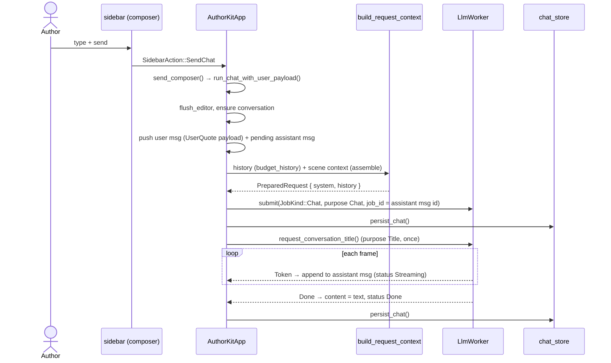
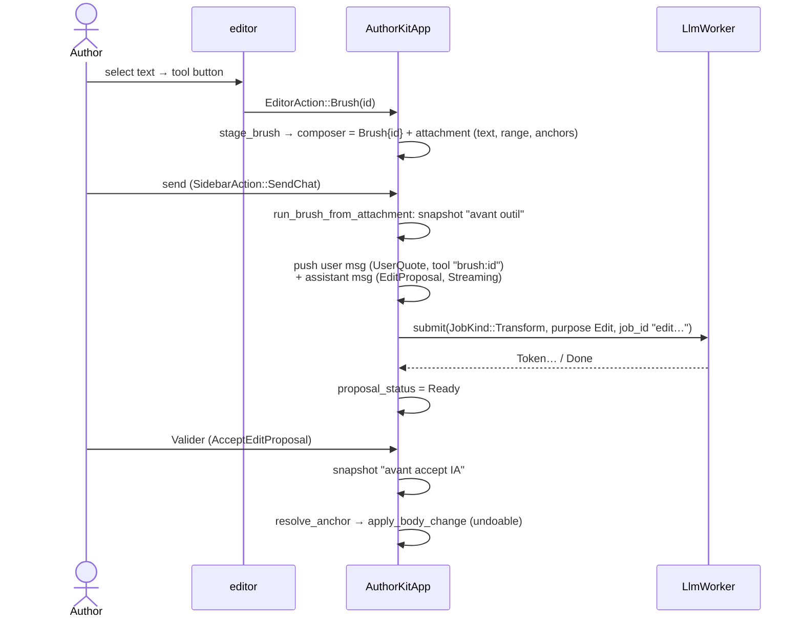
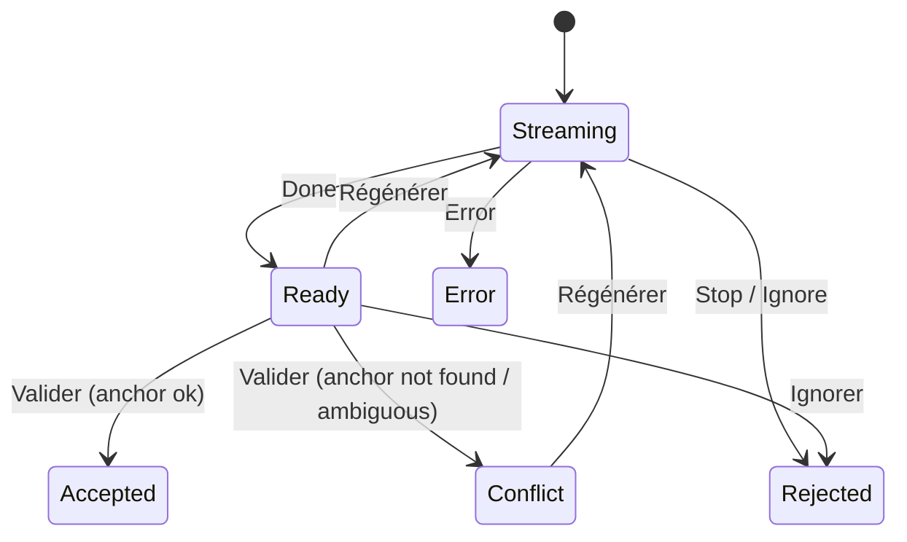

# Chat, tools & edit proposals

The sidebar chat is the single entry point for AI work. Plain chat produces assistant messages;
**tools** (brushes) and **continue** modes produce **edit proposals** — assistant messages that
carry a diff target in the document and can be accepted (undoable), regenerated or ignored.

## Composer modes

`ComposerMode` (in `chat_store.rs`):

| Mode | Needs attachment | Sends | Result |
|------|------------------|-------|--------|
| `Chat` | no (optional) | `JobKind::Chat`, purpose `Chat` | Assistant message |
| `Continue { mode }` (`continue`, `sentence`, `paragraph`, `generate`) | no | `JobKind::Continue`, purpose `Edit` | Edit proposal, insert at cursor |
| `Brush { id }` | yes | `JobKind::Transform`, purpose `Edit` | Edit proposal, replace selection |

**Staging, not running.** Selection toolbar buttons, slash commands and "Au chat" only *stage*
the composer (mode + attachment) and switch to the Chat tab. Nothing is sent until the author
presses send. This is covered by the `stage_brush_does_not_start_job` test.

## Chat turn

- The user message's payload is `MessagePayload::UserQuote { quote, label, note, tool }` so the
  bubble can show the intent (tool icon + name), the linked text, then the message.
- Replies whose `conversation_id` is not the displayed conversation are merged into the stored
  conversation on disk (`merge_chat_reply_offscreen`).
- Errors set the assistant message to `Error` with the (redacted) message; the input is restored
  when no API key is configured.

## Tool / continue turn (edit proposal)

### `EditProposal` payload

Stores everything needed to apply the result later, even if the author kept typing:
`mode` (`ReplaceSelection` / `InsertAtCursor`), `range_start`/`range_end` (char indices),
`doc_id`/`doc_kind`, `original_slice`, `anchor_before`/`anchor_after` (up to 40 chars each),
`proposal_status`, `regen` (how to regenerate), `job_id`.

### Anchor resolution

`app::resolve_anchor(current, start, end, original_slice, before, after, mode)`:

1. If the original range still contains `original_slice` with matching context → use it.
2. Otherwise search the document for `before + slice + after` (or `before` for inserts).
3. Exactly one match → apply there. Zero or several → `AnchorError` → proposal status
   `Conflict` ("Le passage a changé").

This lets the author keep editing while a proposal streams, without the AI result landing in the
wrong place.

### Proposal states

Regenerate re-runs the same tool (or continue mode) from the **current** editor selection.

## Conversation titles

After the first turn, a `JobPurpose::Title` job asks for a 3–6 word summary of the intent. Until it
returns, the title is derived locally by `sidebar::intent_title` (tool label + excerpt, or the
first sentence of the message). Once generated (`title_generated = true`) it is kept.

## Persistence

Conversations are stored per project in `.authorkit-rust/chat/<id>.json` with an `index.json`
tracking the active conversation per context (`scene:<id>`, `note:<id>`). Each conversation also
stores the composer draft, mode and attachment so staged work survives restarts. Format:
[reference/file-formats.md](../reference/file-formats.md#chat).
