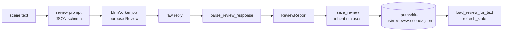
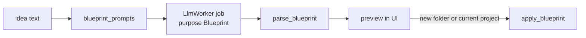

# Coherence (`crates/ak-coherence`)

`ak-coherence` holds the "editorial assistant" features that are not chat: scene reviews,
content ideas, and novel blueprints. It owns the **prompts, response parsing and persistence**;
the desktop app runs the prompts on the background worker (`JobPurpose::Review`, `Ideas`,
`Blueprint`) so the UI never blocks.

The crate also exposes synchronous helpers (`run_review`, `content_ideas`,
`generate_blueprint`, `bootstrap_novel`) that call `OpenAiCompatClient::complete` directly; they
are useful for scripts and tests but are not used by the desktop app.

## Reviews

- `ReviewItem { id, scene_id, severity ("info" | "warn" | "error"), title, detail, suggestion,
  passage, status, stale }`, `ReviewStatus { ToDo, Done, Ignored }`.
- **Robust parsing** — `parse_review_response` accepts fenced JSON, a bare array, or the outermost
  `{…}`; normalises severities (including French words); keeps `passage` only if it appears
  verbatim in the scene; and always sets `id`, `status`, `stale`, `scene_id` locally so the model
  cannot inject them.
- **Staleness** — `text_fingerprint` (FNV-1a 64 of the trimmed text) is stored with the report;
  when the scene changes, items are marked `stale`.
- **Status carry-over** — `save_review` calls `inherit_statuses(previous)` so items the author
  already marked Done/Ignored keep that status on re-run (matched by title + passage + severity).
- Errors: `ReviewError::{EmptyResponse, InvalidJson { reason, excerpt }, Storage}`.

## Content ideas

Prompt asks for `{"ideas": [{"title", "pitch"}]}`. The desktop parses the reply
(`app::parse_ideas_json`); on failure, a single idea containing the raw text is shown. "Write
this" fills the composer and sends it as a chat turn.

## Novel blueprint

- `NovelBlueprint { title, premise, characters[{name, summary}], chapters[{title, summary}],
  chapter1_preview }`.
- `apply_blueprint(&mut Project, &bp)` soft-deletes existing acts (recoverable from trash), sets
  title and premise, creates "Acte I" with one chapter + scene per blueprint chapter (the first
  scene gets `chapter1_preview`, the others a `<!-- Résumé: … -->` comment), and creates one
  Character note per character. When applied to the current project, the app snapshots first
  ("avant blueprint").

## Scene context

`scene_context(project, scene)` builds an `LlmContext` for a scene with its linked notes (dangling
links skipped). It is the entry point the desktop uses for all scene-bound requests; see
[context-assembly.md](context-assembly.md).
