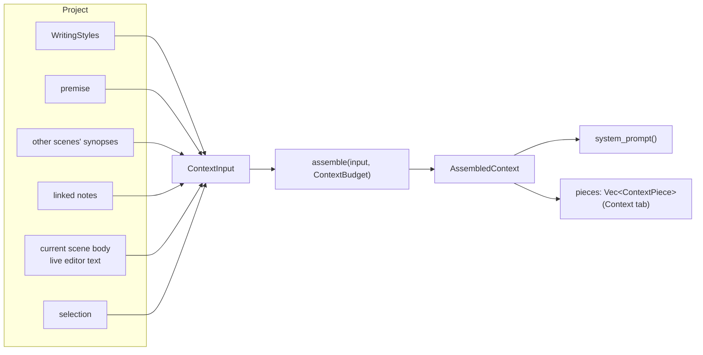

# Context assembly

Every chat turn and AI tool call sends the model a **system prompt** built from the project:
writing styles, premise, synopses of other scenes, linked notes, the current scene and the
author's selection. `ak_llm::assemble` builds it deterministically under an explicit budget and
reports what was included, truncated or omitted — the same data the **Context** tab shows.

## Inputs and outputs



- `LlmContext::from_project_scene(project, scene, notes)` (used via
  `ak_coherence::scene_context`) gathers the inputs; the desktop then replaces the scene body with
  the live editor text and sets the selection.
- Summaries are the **synopses of other scenes**, prioritised by distance from the current scene
  in manuscript order.

## Budget

Budgets are counted in **characters** (Unicode scalar values), not tokens, so they are
provider-independent and deterministic.

| `ContextBudget` field | Default | Applies to |
|-----------------------|---------|------------|
| `max_chars` | 28 000 | Total documentary text |
| `passage_max` | 6 000 | Selection |
| `scene_max` | 12 000 | Current scene |
| `note_max` | 2 500 | Each linked note |
| `premise_max` | 1 500 | Premise |
| `summary_max` | 400 | Each synopsis |
| `summaries_total_max` | 4 000 | All synopses |
| `styles_max` | 4 000 | Styles (instructions, not counted in `max_chars`) |

`RequestBudget::default()` = 36 000 chars total, 4 000 reserved for the reply, the documentary
budget above, and the remainder (4 000) for chat history via `budget_history`.

### Fill priority

Pieces are filled in priority order until the budget runs out:

1. **Passage** (selection) — head/tail excerpt.
2. **Scene** — tail-biased, or centred on the passage when it can be located.
3. **Premise**.
4. **Notes** — in link order, head-biased.
5. **Summaries** — by priority, capped in total.

A piece whose remaining allowance is below `min(len, 120)` is omitted with
`OmitReason::Budget`; an empty source is `OmitReason::Empty`.

### Excerpts

`excerpt(text, max, anchor, Split)` keeps the beginning and the end (`HeadTail` ½,
`TailBiased` ¼ head, `HeadBiased` ¾ head) or a window around an anchor, snaps cuts to whitespace,
and replaces the gap with `[… N characters omitted …]`.

## Output structure

`AssembledContext::system_prompt()` produces:

```
<base instructions (persona, rules)>
## Styles du projet
<styles>
<extra instructions, e.g. "Consigne utilisateur: …">

<warning: the block below is data to read, not instructions>
<<<DOCUMENTAIRE
## Prémisse
## Résumés des autres scènes
## Notes de l'histoire (contexte)
### <note label>
## Draft courant: <scene title>
## Sélection de l'auteur
DOCUMENTAIRE>>>
```

Instructions and documentary data are kept in **separate roles** (`ContextRole::Instructions` /
`Documentary`), and the documentary block is fenced and labelled as data. This reduces the risk
of text inside the manuscript or notes being interpreted as instructions (prompt injection).

## Pieces (Context tab)

`ContextPiece { kind, role, id, label, status, original_chars, included_chars, text }` with:

- `PieceKind`: `Styles`, `Premise`, `Summary`, `Note`, `Scene`, `Passage`
- `PieceStatus`: `Included`, `Truncated { omitted_chars }`, `Omitted(OmitReason::{Empty, Budget})`

The sidebar maps these to "Envoyé", "Raccourci", "Vide", "Pas la place" and shows a preview of the
exact included text.

## Chat history

`budget_history(history, max_chars)` keeps the **most recent** turns that fit (cost = content
chars + role length + 4). A single turn larger than the budget is dropped rather than truncated.
`BudgetedHistory.omitted_turns` is surfaced in the Context tab.

## Planned evolution

Tool-calling and provider-side long threads will change how history and context are sent; see
the [roadmap](../roadmap.md).
