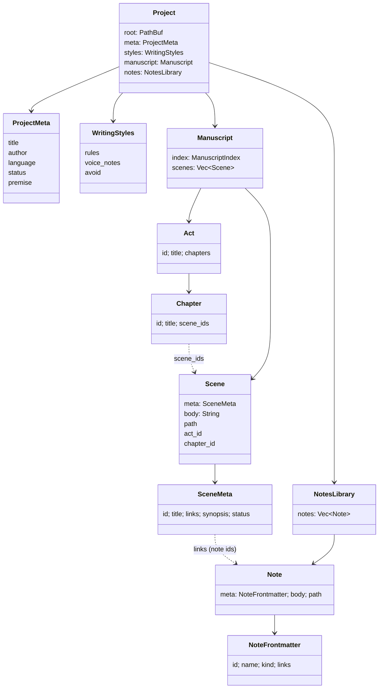

# Data model & storage

A project is a plain folder. Everything the author writes is human-readable (Markdown bodies,
JSON frontmatter, TOML metadata) so it can be versioned with Git, synced, or read without the
app. App-private state lives in a hidden `.authorkit-rust/` subfolder.

## Project folder

```
my-novel/
├── authorkit.toml                 # [book] metadata + [styles]
├── .gitignore                     # created by the app: .authorkit-rust/, .DS_Store
├── manuscript/
│   ├── index.json                 # structure: acts → chapters → ordered scene ids
│   └── scenes/<slug>-<id8>.md     # one file per scene
├── notes/
│   ├── characters/<slug>-<id8>.md
│   ├── settings/<slug>-<id8>.md
│   └── lore/<slug>-<id8>.md
├── prompts/brushes/               # created, currently unused
└── .authorkit-rust/               # app-private, gitignored
    ├── state.json                 # {"format_version": 1}
    ├── chat/                      # conversations + index.json
    ├── versions/<kind>/<id>/      # document snapshots
    ├── trash/                     # soft-deleted items
    └── reviews/                   # coherence reviews per scene
```

Exact field-by-field formats are in [reference/file-formats.md](../reference/file-formats.md).

## Domain model



- **Ordering** lives only in `manuscript/index.json`. Scene files hold content and metadata, not
  position. `Scene.act_id` / `chapter_id` are resolved from the index at load time.
- **Links** between scenes and notes are stored on the scene (`SceneMeta.links`, note ids).
  `NoteFrontmatter.links` exists in the schema but the app links from the scene side.
- **`SceneStatus`**: `ToWrite`, `Draft`, `ToRevise`, `Done` (serialized snake_case).
- **`NoteKind`**: `Character`, `Setting`, `Lore` → folders `characters`, `settings`, `lore`.
- **IDs** are UUID v4 strings. File names are `slugify(title)-<first 8 chars of id>.md`;
  renaming a scene does not rename its file.

## Lifecycle

| Operation | API |
|-----------|-----|
| Create | `Project::create(root, title, author)` — refuses an existing project, writes `authorkit.toml`, folders, `.gitignore`, default "Acte I / Chapitre 1 / Scène d'ouverture" |
| Open | `Project::open(root)` or `open_with_diagnostics(root)` → `ProjectOpen { project, diagnostics }` |
| Structure | `Manuscript::{add_act, add_chapter, add_scene, rename_*, move_scene, move_chapter, move_act}` |
| Content | `Manuscript::save_scene`, `NotesLibrary::{create, save_note, rename}` |
| Links | `Manuscript::{link_note, unlink_note}` |
| Delete | `delete_*` → soft delete to trash (see [persistence-and-safety.md](persistence-and-safety.md)) |

## Open diagnostics

`open_with_diagnostics` runs `inspect_project`, which never blocks opening but reports:

| Code | Severity | Meaning |
|------|----------|---------|
| `broken_scene_ref` | Error | `index.json` references a scene id with no file |
| `orphan_scene` | Warning | A scene file is not referenced by the index |
| `broken_note_link` | Warning | A scene links a note id that doesn't exist |
| `unreadable_scene` / `unreadable_note` | Error | Missing/unterminated frontmatter, invalid JSON, empty id (or empty scene title) |

Unreadable files are skipped at load time, so a single corrupt file cannot prevent the project
from opening.

## Global (per-user) state

Stored under `~/.authorkit-rust/` (or `$AUTHORKIT_HOME`): `ui.json`, `llm_settings.json`, and
`secrets/`. See [reference/configuration.md](../reference/configuration.md).
