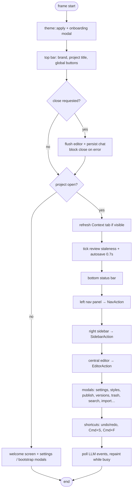
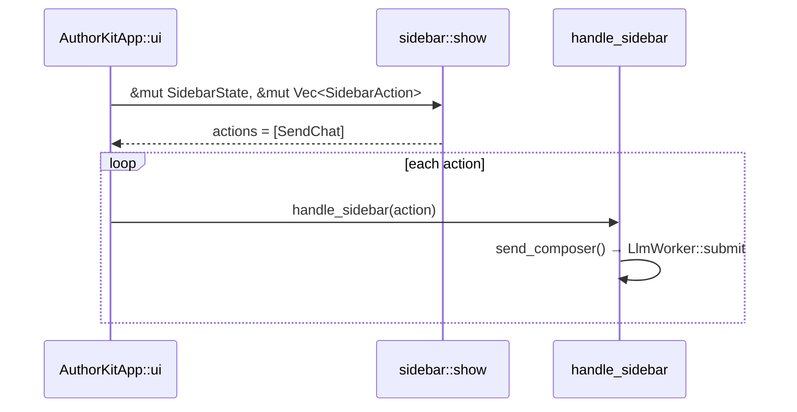

# Desktop app (`apps/desktop`)

The desktop crate is an [eframe](https://docs.rs/eframe) application using
[egui](https://docs.rs/egui) 0.34 in immediate mode, styled with `shadcn-egui`. It is built as
both a binary (`src/main.rs`) and a library (`src/lib.rs`) so integration tests in
`apps/desktop/tests/` can drive `AuthorKitApp` without a window.

## Modules

| Module | Role |
|--------|------|
| `app.rs` | `AuthorKitApp`: all state, frame loop, action dispatch, LLM orchestration, modals |
| `panels/nav.rs` | Left panel: manuscript tree (acts → chapters → scenes) and Notes ("Univers") |
| `panels/editor.rs` | Center: scene/note editor, selection toolbar, slash palette, synopsis modal, `EditorState`, `SaveStatus` |
| `panels/sidebar.rs` | Right panel: Chat / Context / Ideas / Reviews tabs, composer, `SidebarState` |
| `panels/welcome.rs` | Start screen (recent projects, new / open / new idea) |
| `panels/onboarding.rs` | First-launch provider + API key setup |
| `chat_store.rs` | Conversation persistence, message payloads, composer mode |
| `chat_md.rs` | Lightweight Markdown renderer for chat bubbles |
| `md_layout.rs` | Markdown highlighter for the visual editor |
| `ms_tools.rs` | Project search, Markdown import, chapter read-through |
| `providers.rs` | Provider presets, logos, model lists |
| `theme.rs` | `UiPrefs` (persisted), light/dark theme, font size constants |
| `i18n.rs` | `Lang { Fr, En }` and UI strings |
| `widgets.rs` | Shared button/icon helpers, `FadeDialog` |
| `brand.rs` | Window icon and in-app mark |

## Startup

`main.rs` loads `UiPrefs`, opens a 1320×860 viewport (minimum 980×640) with the brand icon,
applies the theme and constructs `AuthorKitApp::new`. In release builds on Windows the binary
uses the `windows` subsystem (no console window).

## Frame loop

`impl eframe::App for AuthorKitApp` implements `ui(&mut self, ui, frame)` (eframe 0.34 hook).
Each frame:

The status bar is drawn before the side panels so it spans the full window width. Side panels
are resizable (nav 280–420 px, sidebar 280–520 px); widths are saved in `UiPrefs` when a drag
ends. Inside the nav, the manuscript tree and the Univers list scroll separately. A drag handle
between them stores the split in `UiPrefs.manuscript_height`.

## Action dispatch pattern

Panels are pure-ish view functions. They read state, draw widgets and **push actions into a
`Vec`** instead of mutating `AuthorKitApp`. The app then handles each action. This keeps borrow
scopes short (a common egui pattern) and makes behaviour testable by calling the handler
directly.

| Panel | Action enum | Handler |
|-------|-------------|---------|
| `nav` | `NavAction` (select, add / rename / delete / move act·chapter·scene·note, read chapter) | `handle_nav` |
| `editor` | `EditorAction` (slash continue/sentence/paragraph/generate, brush, add to chat, link/unlink note, export, synopsis) | `handle_editor` |
| `sidebar` | `SidebarAction` (send / cancel chat, conversations, copy / insert / replace, accept / reject / regenerate / stop edit proposal, composer mode, ideas, reviews) | `handle_sidebar` |
| `welcome` | `WelcomeAction` struct of flags | inline in `ui` |

Tests in `apps/desktop/tests/stabilisation.rs` call these handlers on an
`AuthorKitApp::for_tests(root)` instance.

## Main state (`AuthorKitApp`)

| Field(s) | Meaning |
|----------|---------|
| `project: Option<Project>` | Open project (from `ak-core`) |
| `selection: NavSelection` | `Scene(id)`, `Note(id)`, or legacy `Styles` / `Publish` |
| `editor: EditorState` | Body, selection (char indices), undo/redo, save status, disk fingerprint |
| `sidebar: SidebarState` | Messages, composer, active tab, context pieces, ideas, review |
| `prefs: UiPrefs`, `llm: LlmSettings` | Persisted global preferences |
| `llm_worker: LlmWorker` | Background job runner |
| `brushes: Vec<Brush>` | Built-in AI tools |
| `*_open` flags, `Option<OpenModal<…>>` | Modal visibility and pending modal data |
| `title_pending`, `synopsis_job_id`, `blueprint_job_id`, `pending_sidebar_job` | Routing of background job results |
| `external_conflict`, `close_block` | Save-conflict and close-blocking state |

## Sidebar

Tabs: **Chat**, **Context** ("Contexte"), **Ideas** ("Idées"), **Reviews** ("Révisions").

- **Chat** — header (conversation title, history, new), message list (`chat_bubble` or
  `edit_proposal_card`), and a composer pinned to the bottom. The composer has an optional
  attachment chip (linked text), the input, and a mode chip (`ComposerMode`: Chat, Continue,
  or a tool when text is attached).
- **Context** — what the model receives for this scene: budget meter, then grouped pieces
  (Scene, Linked notes, Story, Guidelines) with status and a preview. Data comes from
  `ak_llm::assemble` (see [context-assembly.md](context-assembly.md)).
- **Ideas** / **Reviews** — results of the corresponding LLM jobs
  (see [coherence.md](coherence.md)).

## Editor

`editor::show_scene` / `show_note` render a header (title, status, synopsis, Visual/Code
switch), linked-note chips and the draft `TextEdit`. Selecting text shows a toolbar (bold,
italic, heading, quote, bulleted list, "Au chat", first tools, more). Typing `/` at a word
boundary opens the slash palette (continue, sentence, paragraph, generate).

Editor persistence and conflict handling are described in
[persistence-and-safety.md](persistence-and-safety.md).

## Preferences and localisation

- `UiPrefs` (theme, panel visibility and sizes, onboarding flag, recent projects, locale) is
  stored in `~/.authorkit-rust/ui.json`.
- `i18n.rs` provides `Lang { Fr, En }` with a `tr(lang, fr, en)` helper. French is the default
  locale. Some strings in `app.rs` and panels are not yet routed through `i18n.rs`.

## Conventions for UI code

See [`.cursor/rules/egui-ui.mdc`](../../.cursor/rules/egui-ui.mdc) (mirrored for Claude Code in
`.claude/rules/`). In short: panels emit actions, no blocking network work on the UI thread,
theme font constants (`FONT_UI`, `FONT_UI_SM`, `FONT_TITLE`), and stable `egui::Id`s for widgets
created in loops.
