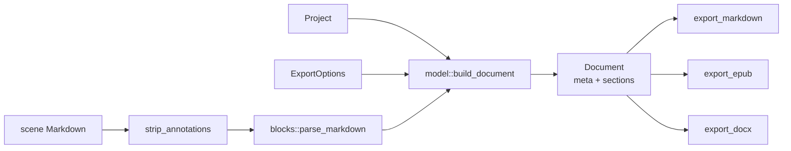

# Export (`crates/ak-export`)

All three formats share one pipeline: scene Markdown is parsed into a small block model, the
manuscript is assembled into a `Document` according to `ExportOptions`, and a renderer writes
the target format.

## Block model (`blocks.rs`)

- `Block::{Heading { level, spans }, Paragraph(spans), Rule, SceneBreak(text)}`,
  `Span { text, bold, italic }`.
- `parse_markdown`: blank lines separate paragraphs; soft line breaks inside a paragraph are kept;
  ATX headings `#`–`######`; rules `---`, `***`, `___`.
- `parse_inline`: `*`/`_` italic, `**`/`__` bold, `***` both; unmatched markers stay literal;
  intra-word `_` is ignored; backslash escapes.
- `strip_annotations`: removes `<!-- … -->` and `%% … %%` (author notes never reach readers).

## Document assembly (`model.rs`)

`ExportOptions` (defaults in parentheses): `title`, `author`, `language` overrides (none),
`include_act_titles` / `include_chapter_titles` / `include_scene_titles` (true),
`chapter_breaks` (true), `strip_annotations` (true), `title_page` (true),
`scene_break` (`"* * *"`).

- One section per chapter in index order (an act without chapters becomes its own section).
- Heading levels are assigned only to visible title levels; headings inside a scene are shifted
  below them (max level 6).
- Scene breaks are inserted between scenes only when scene titles are hidden.
- Language must pass `is_valid_lang` (loose BCP 47) or falls back to `fr`.

## Renderers

| Format | Notes |
|--------|-------|
| Markdown | Title, author, premise, then `#` acts / `##` chapters / `###` scenes; scene bodies kept as authored (annotations stripped if enabled) |
| EPUB 3 | `mimetype` first and stored uncompressed, `container.xml`, `content.opf` (`urn:authorkit:<hash>` identifier, `dcterms:modified`), `nav.xhtml`, CSS, optional title page, one XHTML per chapter (or one file without chapter breaks); XML-illegal characters removed |
| DOCX | `docx-rs`; real `Title` / `Author` / `Heading1–6` styles with outline levels, bold/italic runs, page break before each chapter, centred `* * *` rules |

Exports are triggered from the Publish dialog (`EditorAction::ExportMarkdown` / `ExportEpub` /
`ExportDocx`); the editor is flushed first. Tests in `crates/ak-export/tests/export_content.rs`
unzip outputs and assert structure and text.
