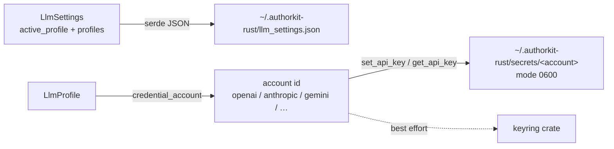
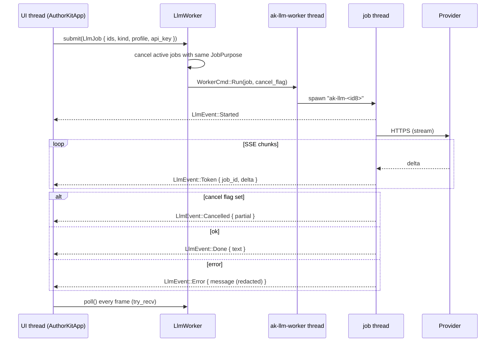

# LLM layer (`crates/ak-llm`)

`ak-llm` owns everything between "the app wants a completion" and "bytes come back from a
provider": settings, API keys, the HTTP client, SSE stream parsing, context assembly
([separate page](context-assembly.md)) and the background worker.

## Providers

| `ProviderKind` | Default base URL | Default model | Protocol |
|----------------|------------------|---------------|----------|
| `OpenAiCompatible` (default) | `https://api.openai.com/v1` | `gpt-5-mini` | `POST {base}/chat/completions` |
| `Anthropic` | `https://api.anthropic.com/v1` | `claude-sonnet-4-5` | `POST {base}/messages` |
| `Ollama` | `http://127.0.0.1:11434/v1` | `llama3.2` | OpenAI-compatible, no key |

The desktop UI (`apps/desktop/src/providers.rs`) offers presets for OpenAI, Anthropic, Gemini,
Mistral, DeepSeek, xAI, OpenRouter, Groq and Ollama; all except Anthropic go through the
OpenAI-compatible protocol with a different base URL.

## Settings and secrets

- `LlmSettings { active_profile, profiles: Vec<LlmProfile> }` — never contains a key. Missing or
  corrupt JSON falls back to defaults ("Par défaut" OpenAI + "Ollama").
- `LlmProfile { name, provider, base_url, model, keyring_account }`.
- `credential_account(profile)` derives a **stable account id from the endpoint** (so several
  profiles on the same provider share one key): `openai`, `anthropic`, `gemini`, `mistral`,
  `deepseek`, `xai`, `openrouter`, `groq`; otherwise `keyring_account`, a slug of the profile
  name, or `default`. Ollama returns `None` (no key).
- **Primary key store**: one file per account in `~/.authorkit-rust/secrets/`, permission `0600`
  on Unix. `set_api_key` writes the file, mirrors to `keyring` best-effort, then reads the file
  back to verify. `get_api_key` tries candidate accounts, file first.
- The `keyring` dependency is currently built without platform backends, so the mirror is not a
  real OS keychain — see [known issues](../reference/known-issues.md).

## HTTP client (`OpenAiCompatClient`)

- `complete(&GenerationRequest)` and `stream_complete(&GenerationRequest, &AtomicBool, on_token)`.
  `GenerationRequest { system, messages: Vec<ChatMessage { role, content }> }`.
- `reqwest::blocking`, rustls TLS; timeouts 120 s (non-streaming) / 180 s (streaming).
- **OpenAI-compatible**: bearer auth, `{model, messages:[system, …], temperature?, stream?}`.
  `temperature` is omitted for models that only accept the default (`gpt-5*`, `o1`/`o3`/… —
  `temperature_for_model`), otherwise `0.7`.
- **Anthropic**: `x-api-key`, `anthropic-version: 2023-06-01`, top-level `system`,
  `max_tokens: 4096`.
- **Streaming**: the response body is read in 2 KiB chunks into `SseLineParser`; deltas are
  extracted by `openai_sse_delta` / `anthropic_sse_delta`. The cancel flag is checked between
  reads. If a stream yields nothing (and was not cancelled), the client retries once without
  streaming.
- Errors go through `Error::api_redacted` and `redact_secrets` (masks the exact key and
  `sk-…`, `gsk_…`, `xai-…`, `Bearer …` tokens). `Debug` for the client and jobs prints
  `<redacted>`.

## Background worker (`worker.rs`)

### Types

| Type | Values |
|------|--------|
| `JobPurpose` | `Chat`, `Edit`, `Ideas`, `Review`, `Blueprint`, `Title` |
| `JobKind` | `Chat { system, history, user }`, `Continue { system, tail, mode }`, `Transform { system, instruction, selection }`, `Complete { system, user }`, `Mock { reply, stream_chunks }` |
| `JobIds` | `job_id`, `project_root`, `conversation_id`, `doc_id`, `text_version`, `purpose` |
| `LlmEvent` | `Started`, `Token`, `Done`, `Error`, `Cancelled` |

`JobKind::Mock` never touches the network and is used by tests.

### Cancellation semantics

- `submit` cancels every active job **with the same purpose**, so a new chat turn doesn't kill
  an in-flight tool edit and vice versa.
- `cancel_job(id)`, `cancel_purpose(p)` and `cancel()` (all jobs) set the flags.
- Cancellation is cooperative: it takes effect at the next stream read.
- `is_busy()` / `is_purpose_busy(p)` reflect active jobs; entries are removed when `Done`,
  `Error` or `Cancelled` is polled.

### Result routing in the app

`AuthorKitApp::handle_llm_event` routes events by `job_id`: chat and edit-proposal messages use
the job id as their message id; title, synopsis and blueprint jobs use dedicated prefixes /
fields. A `Done` whose `project_root` differs from the open project is dropped; a chat or edit
reply for a conversation that is no longer displayed is merged into the stored conversation on
disk. Details: [chat-and-edit-proposals.md](chat-and-edit-proposals.md).

## Built-in tools ("brushes")

`builtin_brushes()` returns `Brush { id, label, instruction }`:

| id | UI label |
|----|----------|
| `improve` | Améliorer |
| `shorten` | Raccourcir |
| `lengthen` | Allonger |
| `grammar` | Grammaire |
| `simplify` | Simplifier |
| `readable` | Lisibilité |

They are shown as **Outils / Tools** in the UI. To add one, see
[guides/adding-an-ai-tool.md](../guides/adding-an-ai-tool.md).
