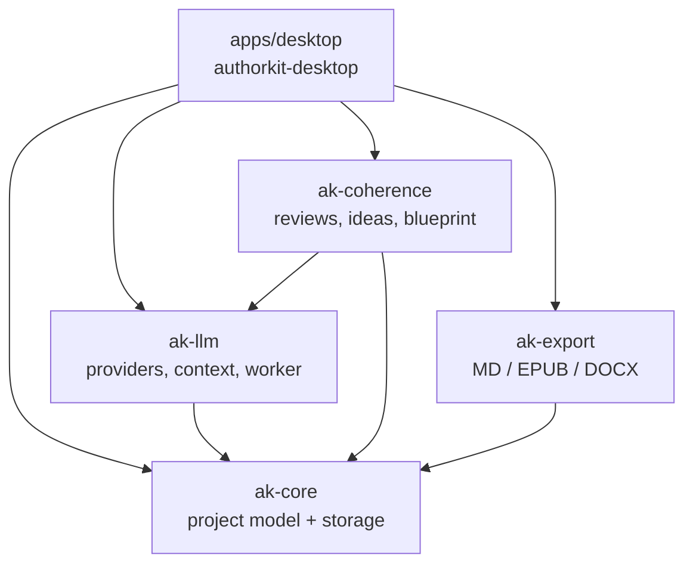
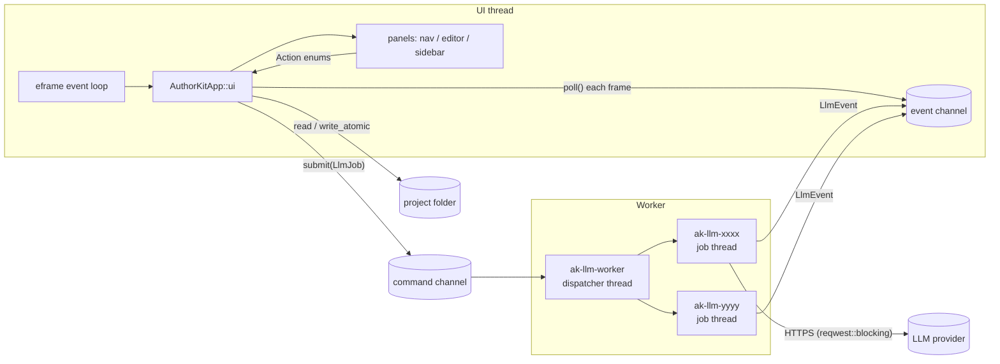

# Architecture overview

AuthorKit is a single native desktop application backed by four library crates in one Cargo
workspace. There is no server: projects are plain folders on disk, and LLM calls go directly
from the user's machine to the provider they configured (BYOK — bring your own key).

## Workspace layout

```
Cargo.toml              # workspace: members, shared metadata, shared dependency versions
apps/
  desktop/              # authorkit-desktop — egui binary + lib (lib exposed for integration tests)
crates/
  ak-core/              # project model and on-disk storage
  ak-llm/               # providers, secrets, context assembly, background worker
  ak-coherence/         # reviews, content ideas, novel blueprints
  ak-export/            # Markdown / EPUB 3 / DOCX export
docs/                   # this documentation
scripts/                # coverage, icon generation, release packaging
.github/workflows/      # CI (lint, test, coverage) and release
```

The layout follows the common "flat `crates/` folder + workspace inheritance" pattern described in
the [Cargo book (workspaces)](https://doc.rust-lang.org/cargo/reference/workspaces.html) and the
[Microsoft Pragmatic Rust Guidelines](https://microsoft.github.io/rust-guidelines/guidelines/project/)
(`M-CARGO-WORKSPACE`, `M-CRATES-FLAT-FOLDER`). Version, edition, license, authors, homepage and
repository are inherited from `[workspace.package]`; shared dependency versions come from
`[workspace.dependencies]`.

## Crate dependency graph



| Crate | Responsibility | Notable external deps |
|-------|----------------|-----------------------|
| `ak-core` | Project, manuscript (acts / chapters / scenes), notes, styles, trash, versions, diagnostics, atomic writes | `serde`, `serde_json`, `toml`, `uuid`, `chrono`, `thiserror` |
| `ak-llm` | Provider settings, API-key storage, HTTP client (OpenAI-compatible + Anthropic), SSE parsing, context assembly, background worker | `reqwest` (blocking, rustls), `keyring`, `dirs` |
| `ak-coherence` | Review prompts/parsing/persistence, content ideas, novel blueprint generate/parse/apply | — |
| `ak-export` | Markdown → block model → Markdown / EPUB 3 / DOCX | `zip`, `docx-rs` |
| `authorkit-desktop` | egui UI, chat persistence, editor, dispatch of every user action | `eframe`/`egui` 0.34, `shadcn-egui`, `egui_commonmark`, `rfd` |

Rule of thumb: **domain logic lives in `crates/`, UI and orchestration live in `apps/desktop`.**
`ak-core` depends on no other workspace crate.

## Runtime model



- **One UI thread** runs eframe in immediate mode. Every frame, `AuthorKitApp::ui` draws all
  panels; panels never mutate the app directly but return small action enums that `app.rs`
  dispatches (see [desktop-app.md](desktop-app.md)).
- **No async runtime in application code.** LLM calls use `reqwest::blocking` on dedicated
  threads. The `LlmWorker` has a dispatcher thread and spawns one thread per job; communication
  uses `std::sync::mpsc` channels and `Arc<AtomicBool>` cancel flags.
- **File I/O is synchronous on the UI thread** (projects are small text files). Writes to
  project data go through `ak_core::fsutil::write_atomic`.
- **Native dialogs** use `rfd` (open / save / pick folder).

## Where state lives

| State | Location | Owner |
|-------|----------|-------|
| Manuscript, notes, styles, metadata | `<project>/` (Markdown + JSON frontmatter, TOML) | `ak-core` |
| Chat conversations | `<project>/.authorkit-rust/chat/` | `apps/desktop/src/chat_store.rs` |
| Versions, trash, reviews | `<project>/.authorkit-rust/{versions,trash,reviews}/` | `ak-core`, `ak-coherence` |
| UI preferences | `~/.authorkit-rust/ui.json` | `apps/desktop/src/theme.rs` |
| LLM profiles | `~/.authorkit-rust/llm_settings.json` | `ak-llm::settings` |
| API keys | `~/.authorkit-rust/secrets/<account>` | `ak-llm::settings` |

`~/.authorkit-rust` can be redirected with the `AUTHORKIT_HOME` environment variable (used by
tests). Full details: [reference/configuration.md](../reference/configuration.md).

## Further reading

- [Desktop app](desktop-app.md) · [Data model](data-model.md) · [LLM layer](llm.md) ·
  [Context assembly](context-assembly.md) · [Chat flows](chat-and-edit-proposals.md)
- Decisions behind this shape: [ADR index](../adr/README.md)
