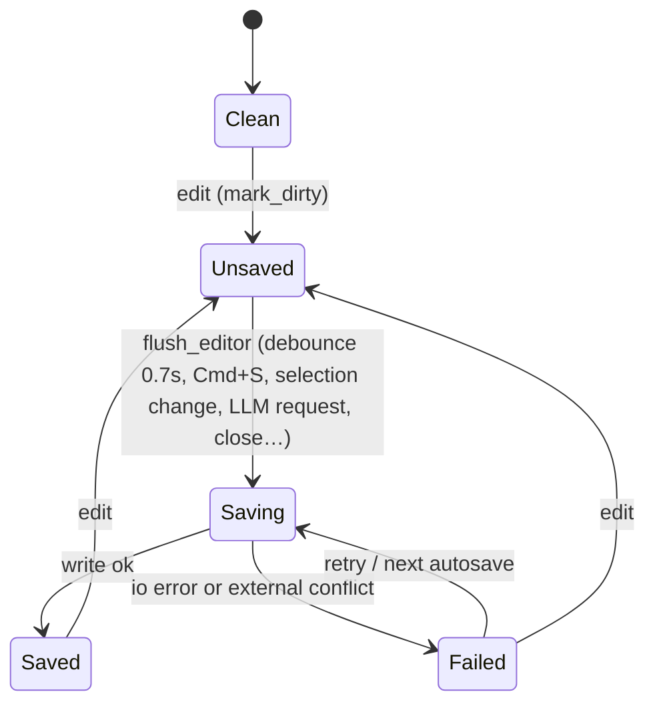
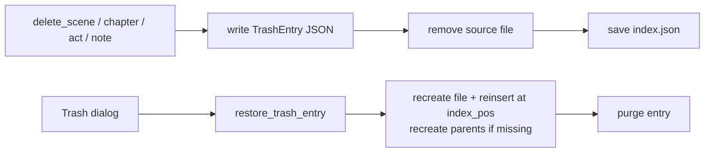

# Persistence & safety

AuthorKit treats the author's text as the most valuable asset. The design goals are: never lose
in-memory work silently, never overwrite external edits blindly, and make destructive actions
recoverable.

## Atomic writes

`ak_core::fsutil::write_atomic(path, bytes)`:

1. creates the parent directory,
2. writes a temp file `.<name>.<pid>.tmp` in the same directory and calls `sync_all`,
3. renames it over the target (removing the destination first on Windows),
4. removes the temp file if anything fails.

All project data (scenes, notes, index, `authorkit.toml`, chat, trash, versions, reviews) is
written this way. Global preference files and Markdown export currently use plain
`std::fs::write` — see [known issues](../reference/known-issues.md).

## Editor save status

- `tick_autosave` flushes 0.7 s after the last edit; a failure re-arms the debounce.
- A `Failed` status keeps the document in memory, blocks project switch and export, and shows a
  retry button in the status bar.
- Closing the window runs `flush_editor` + `persist_chat`; on error the close is cancelled and a
  "retry / close without saving / cancel" dialog is shown.

## External change detection

When a document is opened, the editor records the file's modification time and a content hash.
Before writing, `flush_editor` checks whether the file on disk is newer; if so, it compares hashes
and, on mismatch, refuses to write and opens a conflict dialog:

| Choice | Effect |
|--------|--------|
| Reload | Discard in-memory edits, reload the document |
| Compare | (placeholder) |
| Overwrite | Clear the fingerprint and write the in-memory version |
| Save a copy | Save the in-memory text as a new Lore note "<title> (copie …)" |

The current implementation behaves as an mtime check in practice; see
[known issues](../reference/known-issues.md).

## Undo / redo

`EditorState` keeps `undo_stack` / `redo_stack` of `EditorSnapshot` (capped at 80). Typing is
coalesced into one step when edits are less than one second apart; formatting and accepted AI
edits are discrete steps. Accepting an AI proposal is therefore always undoable.

## Trash (soft delete)

Deleting a scene, chapter, act or note never removes data outright. The item is serialised to
`.authorkit-rust/trash/<entry-id>.json` **before** the source file is removed and the index is
saved.

`TrashEntryKind` is `Scene`, `Chapter`, `Act` or `Note` and stores enough to restore position
(`index_pos`) and nested scenes. If the original path is taken, a new `<slug>-<id8>.md` name is
used; missing parents are recreated ("Acte restauré", "Chapitre restauré").

## Versions

`ak_core::versions` stores document snapshots in
`.authorkit-rust/versions/<doc_kind>/<doc_id>/<uuid>.json` (`VersionSnapshot`: body, title,
meta JSON, reason, timestamp).

| Reason | When |
|--------|------|
| `auto` | After a successful flush, at most every 10 minutes |
| `avant outil` | Before running an AI tool on the selection |
| `avant accept IA` | Before applying an accepted AI edit |
| `avant blueprint` | Before applying a novel blueprint to the current project |
| `avant restauration` | Before restoring an older version (safety copy) |

Retention: automatic snapshots older than 24 h are pruned, and at most 50 snapshots are kept per
document.

## Secrets

API keys are never written to `llm_settings.json` and never printed: error messages, toasts and
`Debug` implementations pass through `ak_llm::redact_secrets`. Storage details are in
[llm.md](llm.md#settings-and-secrets).
