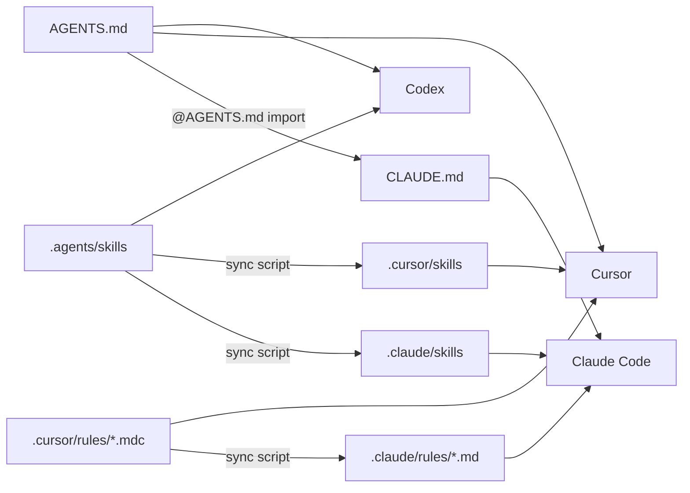

# AI coding assistants

The repository ships configuration so Cursor, Claude Code and OpenAI Codex follow the same
project guidelines. Each tool uses its own documented format; content is shared, not invented
per tool.

## Layout

```text
AGENTS.md                 # canonical project instructions (agents.md format)
CLAUDE.md                 # imports @AGENTS.md + Claude-specific notes
.cursor/rules/*.mdc       # SOURCE of scoped rules (description / globs / alwaysApply)
.claude/rules/*.md        # generated from .cursor/rules (paths: frontmatter)
.agents/skills/<name>/    # SOURCE of skills (SKILL.md: name + description)
.cursor/skills/<name>/    # copy
.claude/skills/<name>/    # copy
scripts/sync-agent-config.sh
```



## How each tool reads it

| Tool | Instructions | Scoped rules | Skills |
|------|--------------|--------------|--------|
| [Codex](https://developers.openai.com/codex/guides/agents-md) | `AGENTS.md` (root + nested) | — (rules are referenced from `AGENTS.md`) | [`.agents/skills/`](https://developers.openai.com/codex/skills) |
| [Cursor](https://cursor.com/docs/context/rules) | `AGENTS.md` | `.cursor/rules/*.mdc` (`globs`, `alwaysApply`) | `.cursor/skills/` |
| [Claude Code](https://docs.claude.com/en/docs/claude-code/memory) | `CLAUDE.md` → `@AGENTS.md` | `.claude/rules/*.md` (`paths:`) | [`.claude/skills/`](https://docs.claude.com/en/docs/claude-code/skills) |

## Rules

| Rule | Applies to | Summary |
|------|-----------|---------|
| `rust-style` | `**/*.rs` | rustfmt, clippy `-D warnings`, API Guidelines naming, `thiserror`, char indices |
| `egui-ui` | `apps/desktop/src/**/*.rs` | panels return actions, never block the frame, stable ids, theme tokens, i18n |
| `persistence` | `crates/ak-core/**`, `chat_store.rs` | `write_atomic`, trash, snapshots, serde-compatible formats |
| `llm` | `crates/ak-llm/**`, `crates/ak-coherence/**` | worker-only HTTP, job purposes, secret redaction, budgets |
| `testing` | tests, coverage script, workflows | layout, isolation, gates |
| `docs` | `docs/**`, root Markdown | Diátaxis, Mermaid, Keep a Changelog, ADRs |

## Skills

| Skill | Use it to |
|-------|-----------|
| `verify-changes` | Run CI checks locally (fmt, clippy, tests, coverage, config sync) |
| `add-ai-tool` | Add a brush / selection tool |
| `add-ui-action` | Add a UI interaction via action dispatch |
| `add-llm-job` | Add a background model request |
| `cut-release` | Bump version, changelog, tag |

## Editing

1. Edit `AGENTS.md`, `.cursor/rules/*.mdc` or `.agents/skills/**` only.
2. Run `./scripts/sync-agent-config.sh`.
3. Commit the generated files. CI runs `./scripts/sync-agent-config.sh --check` and fails on drift.

Keep rules short (well under ~50 lines), concrete and linked to the docs; put long explanations
in `docs/`, not in rules.
