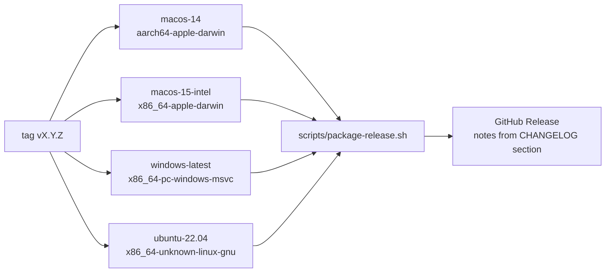

# Releasing

Releases follow [Semantic Versioning](https://semver.org/) and
[Keep a Changelog](https://keepachangelog.com/en/1.1.0/). Pre-1.0, minor bumps may contain
breaking changes.

## Steps

1. Make sure `main` is green (fmt, clippy, tests, coverage).
2. Bump `version` in the root `Cargo.toml` (`[workspace.package]`); all crates inherit it.
3. In `CHANGELOG.md`, rename `[Unreleased]` to `[X.Y.Z] — YYYY-MM-DD`, add a new empty
   `[Unreleased]`, and update the comparison links at the bottom.
4. Commit: `chore(release): vX.Y.Z`.
5. Tag and push:

   ```bash
   git tag -a vX.Y.Z -m "AuthorKit vX.Y.Z"
   git push origin main vX.Y.Z
   ```

6. `.github/workflows/release.yml` builds and publishes:



## Artifacts

| Platform | Artifact | Contents |
|----------|----------|----------|
| macOS | `AuthorKit-X.Y.Z-macos-{arm64,x64}.zip` | `AuthorKit.app` (Info.plist, `AuthorKit.icns`, bundle id `fr.supralab.authorkit`) |
| Windows | `AuthorKit-X.Y.Z-windows-x64.zip` | `AuthorKit.exe` (icon embedded via `winres`), `authorkit.ico` |
| Linux | `AuthorKit-X.Y.Z-linux-x64.tar.gz` | `bin/authorkit`, hicolor icons, `authorkit.desktop` |

Package locally for your host OS with `./scripts/package-release.sh X.Y.Z` (output in `dist/`).

## Icons

Source: `apps/desktop/assets/brand/icon-512.png`. Regenerate all platform icons with
`./scripts/gen-icons.sh` (Pillow in a temporary venv; `.icns` requires macOS `sips`/`iconutil`).

## Not yet automated

- macOS code signing / notarisation and Windows Authenticode signing (builds trigger
  Gatekeeper / SmartScreen warnings).
- Installers (`.dmg`, `.msi`, `.deb`, AppImage).
