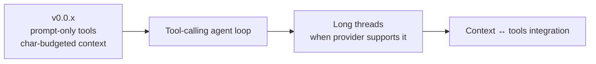

# Roadmap

## Current — v0.0.1 (public preview)

Assemble-and-chat foundation: manuscript + notes + styles, sidebar chat with scene context,
tools and continue modes as undoable edit proposals, Context panel, reviews, ideas, blueprints,
Markdown / EPUB / DOCX export, local-first storage with trash and versions.

## Next major — agent context & long threads

1. **Tool-calling agent loop.** Expose manuscript and notes operations as provider tools
   (read scene, search project, link note, propose edit, …) through the providers' native
   function/tool-calling APIs, so the model can request structured work mid-turn instead of
   relying on prompt-only brushes. Edit tools keep producing edit proposals that the author
   accepts.
2. **Long-thread support.** When the provider offers it (large context windows, prompt caching,
   server-side conversation state), keep multi-turn conversations coherent without aggressive
   history drops. Otherwise fall back to summarisation of older turns plus the existing character
   budget.
3. **Richer context assembly.** Tie the Context panel to what is actually sent each turn, including
   tool results; per-piece include/exclude; per-tool budgets.

Design notes and an ADR will be added when this work starts.

## Hardening backlog

Tracked in [reference/known-issues.md](reference/known-issues.md): real OS keychain backend,
single-send of the current user turn, precise conflict detection, scoped "stop", full i18n,
signing and installers.
